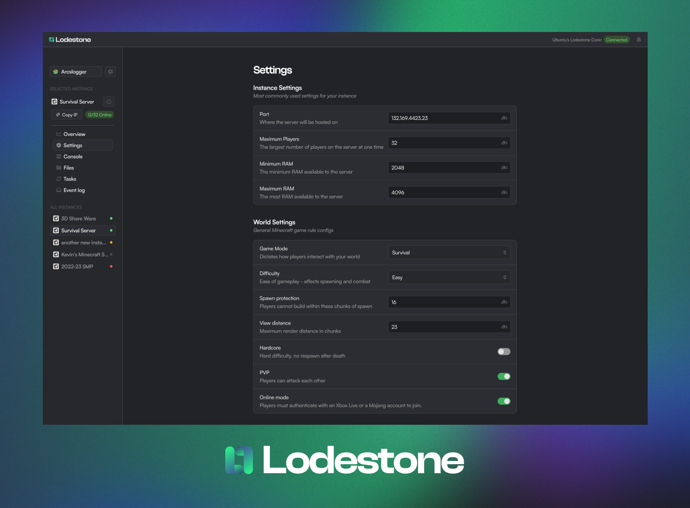

[](https://www.lodestone.cc/)

[![Contributors][contributors-shield]][contributors-url]
[![Issues][issues-shield]][issues-url]
[![Build][workflow-shield]][workflow-url]


# Lodestone

A free, open source server hosting tool for Minecraft and other multiplayers games. Lodestone is designed to be easy to use, secure, and feature-rich. It is built with Rust, React, and TypeScript.

🔗 Get Started: [https://www.lodestone.cc/](https://www.lodestone.cc/)

## Features

- [x] Clean and intuitive UI
- [x] One-click installation and setup
- [x] Real-time server status
- [x] *(New!)* Beautiful and functional file manager (unzip, upload, download, copy, pastes, etc.)
- [x] Collaborative remote server and resource management
- [x] Priority on safety and security
- [x] User permission management
- [x] *(New!)* Extensions via macro (read more [here](https://github.com/Lodestone-Team/lodestone/wiki/Intro-to-Macro-and-Task))
- [x] *(New!)* Connect without port forward via playit.gg integration (read more [here](https://github.com/Lodestone-Team/lodestone/wiki/Playit.gg-Integration))
- [ ] *(New!)* **Manage Docker containers** (WIP 🚧, read more [here](https://github.com/Lodestone-Team/lodestone/wiki/Docker-Instance))

## Future Features
- [ ] Plugin and mod management
- [ ] Complete Docker integrations
- [ ] Event viewer

Have a feature request? Let us know by creating an issue!

## Supported Platforms and Architectures
- Windows (x86_64)
- Linux (x86_64 and ARM)
- MacOS (Apple Silicon)

We are deprecating support for Intel Macs due to the lack of hardware to test on. Get in contact with us if you would like to see additional platform supports.

## Lodestone CLI vs Lodestone Desktop

Lodestone CLI manages the installation and updates of Lodestone Core - the backend of Lodestone. It does not come with a UI (dashboard), so you must use a web dashboard, either hosted by us or yourself.

Lodestone Desktop integrates Lodestone Core and the dashboard into a single application. It is available for Windows only and is not considered stable yet.


## Installation

### Docker

One image runs Lodestone Core and the dashboard. Open `http://localhost:8080`. The page talks to that same address. Core is not published on port 16662.

```sh
docker pull ghcr.io/bravo68web/lodestone
```

From a checkout of this repo:

```sh
docker compose up -d
```

`docker-compose.yml` publishes `8080` for the UI and `25565` for a Minecraft instance. Add a host port for every other game port you use. The first instance create downloads a Java runtime, so the container needs outbound network on first start.

A CIFS/SMB share can be the data directory. Mount it as uid 1000 and gid 1000, for example `uid=1000,gid=1000,file_mode=0660,dir_mode=0770`. The container keeps going if `chown` is rejected. If the share cannot lock files, Core starts without the single-instance lock, so do not point two containers at the same share. SQLite uses delete journaling and waits up to 5 seconds when the share is busy.

To build the image yourself: `docker build -t ghcr.io/bravo68web/lodestone:dev .`

### Windows
You can download Lodestone Desktop for Windows from the [releases page](https://github.com/Lodestone-Team/lodestone/releases). Although we recommend using the CLI, see below.


### Linux and MacOS (Apple Silicon) via CLI
Download and run [Lodestone CLI](https://github.com/Lodestone-Team/lodestone_cli).

If you would like to use the dashboard we hosts:
1. Use a chromium based browser (Chrome, Edge, Brave, etc.) and go to [https://www.lodestone.cc/](https://www.lodestone.cc/)
2. Follow this [guide](https://experienceleague.adobe.com/docs/target/using/experiences/vec/troubleshoot-composer/mixed-content.html?lang=en) to enable mixed content for the site.
3. If you have browser extensions such as HTTPS Everywhere, disable them for the site.

To see why step 2 and 3 are necessary and some possible solutions, see [here](https://github.com/Lodestone-Team/lodestone/wiki/FAQ#why-do-i-need-to-enable-mixedinsecure-content-and-disable-https-is-this-safe)

Alternatively, you can host the dashboard yourself.

## Safety & Security

Lodestone Core is written entirely in safe Rust, and uses`#![forbid(unsafe_code)]`. However **we can't guarantee the safety of the crates and binaries we link to**, as those may use unsafe rust.

Lodestone is created with security as a top priority. While most of the safety critical code such as login and permissions management have been tested thoroughly, **no formal security audit has been done for any part of Lodestone.**

### Safe mode

Safe mode is on by default. It is aimed at a shared Core where other people have accounts.

While it is on:

- A non-owner cannot read or write the host filesystem, write instance files, change instance resources, run instance macros, manage permissions, install extensions, or open the instance shell.
- The owner still can. The owner short-circuit is what makes administration possible while safe mode is on.
- Granting those permissions does not stick. The settings screen disables them, and Core drops them if a client sends them anyway.
- Turning safe mode on removes those grants from every non-owner and writes `users.json`. View, start, stop, console, instance settings, and read access to an instance's own files can stay.

Turning safe mode off does not put the removed grants back. The owner has to grant them again. Core asks for confirmation before safe mode is turned off.

### Backups

The Backups tab saves a stopped instance as `backups/<timestamp>.zip` inside that instance. The zip leaves out the `backups` folder itself, so older zips are not packed into the new one. Restore replaces the instance files from a chosen zip and keeps that folder. The instance id file stays, so the sidebar keeps the same instance. A running server is refused. `backup_period` is stored and is not scheduled. Docker instances are not backed up here. Creating, deleting, and restoring need permission to write instance files, so while safe mode is on those actions stay with the owner. Downloading needs permission to read instance files.

### Server jar

Instance settings can replace the server jar for a stopped Vanilla, Fabric, Paper, or Forge instance. It uses the same download as creating an instance. Fabric and Paper can take a loader or build, and a blank field means the latest stable one. A blank Forge build means the newest build. The new jar is written over `server.jar`. Forge also runs its installer. `world/`, `server.properties`, `mods/`, and the Lodestone id files are copied back afterward. Spigot is refused. The server has to be stopped.

### Mods

A Fabric or Forge instance can install one Modrinth project from the Mods tab. Core searches Modrinth for that loader and Minecraft version, keeps a build that runs on a server, and downloads its jar into `mods/`. Required dependencies are downloaded too. Optional dependencies are not. The file has to come from `cdn.modrinth.com`. Remove deletes that jar only. The server has to be stopped. Ferium and CurseForge are not used.

### Console history

Console output, player messages, and system messages are stored by instance and snowflake as they are written into the live ring. The ring still feeds the open console. Show older reveals lines already loaded, then asks `GET /api/v1/instance/:uuid/console?before=&limit=` for the next older page. Clear removes that instance's stored lines and the ring. The open console draws each server line once. A system message repeats that same line for player tracking, so it is not drawn again.

### Import

An existing Minecraft server can be imported from a zip, or from a directory that is already inside the Lodestone data directory. The copy cannot leave that directory. Import does not start the server or download a jar. When `server.jar` has a `version.json`, the instance stores that game version and Java major. Otherwise the version stays `imported` and the major stays 17. On load, a missing Java command is filled from an installed `jre{major}`. Start tells you which major is missing instead of failing with "No such file or directory". `start.sh` is not used. An imported instance is given 1024 MB minimum and 2048 MB maximum.

### Shell

The Shell tab runs one command inside the instance directory. The allowed programs are `cat`, `cp`, `mv`, `mkdir`, `ls`, `rm`, `zip`, `unzip`, `curl`, and `wget`. Pipes, redirects, and a general shell are rejected. It needs permission to write instance files. While safe mode is on, only the owner can open it.

### Players

While a server is running and RCON is enabled, the player list can show a player's dimension, coordinates, biome, and inventory.


## Contributing

Lodestone is still new and we have *a lot* of features planned for this year. Either way, we'd love to hear your feedback! If you have any suggestions, leave a GitHub issue or talk to us on our [Discord](https://discord.gg/PkHXRQXkf6).


## License

The Lodestone project uses the GNU Affero General Public License v3.0. See our `LICENSE` file for details.

Lodestone and all its components (dashboard, core, macros, etc.) are free for personal use, forever. 

You may use Lodestone for commercial purposes, but you must disclose the source code of any modifications you make to Lodestone. You must also disclose the source code of any software that uses Lodestone's API.

Lodestone team provides absolutely no warranty or guarantee for the software.

For an alternate (non-AGPL) license, contact us by either raising an issue or joining our [Discord](https://discord.gg/PkHXRQXkf6).


## Team

Lodestone wouldn't be here if it weren't for our contributors. Check out our [team](https://github.com/orgs/Lodestone-Team/people) here!

## Support Us

The Lodestone project is being maintained by a passionate team of University students with 0 profits. Consider [buying us a coffee](https://ko-fi.com/lodestone_team) to support our development, we would greatly appreciate it!

## Have questions?

Checkout our FAQ here for more info: https://github.com/Lodestone-Team/lodestone/wiki/FAQ

You can also join our [Discord](https://discord.gg/PkHXRQXkf6) to ask questions and help for setting up Lodestone.


<p align="right">(<a href="#top">back to top</a>)</p>

<!-- MARKDOWN LINKS & IMAGES -->
<!-- https://www.markdownguide.org/basic-syntax/#reference-style-links -->

[contributors-shield]: https://img.shields.io/github/contributors/Lodestone-Team/dashboard?style=for-the-badge
[contributors-url]: https://github.com/Lodestone-Team/dashboard/graphs/contributors

<!-- [forks-shield]: https://img.shields.io/github/forks/github_username/repo_name.svg?style=for-the-badge
[forks-url]: https://github.com/github_username/repo_name/network/members
[stars-shield]: https://img.shields.io/github/stars/github_username/repo_name.svg?style=for-the-badge
[stars-url]: https://github.com/github_username/repo_name/stargazers -->

[issues-shield]: https://img.shields.io/github/issues/Lodestone-Team/dashboard?style=for-the-badge
[issues-url]: https://github.com/Lodestone-Team/dashboard/issues
[workflow-shield]: https://img.shields.io/github/actions/workflow/status/Lodestone-Team/dashboard/desktop.yml?style=for-the-badge
[workflow-url]: https://github.com/Lodestone-Team/dashboard/actions
[license-shield]: https://img.shields.io/github/license/github_username/repo_name.svg?style=for-the-badge
[license-url]: https://github.com/github_username/repo_name/blob/master/LICENSE.txt
[product-screenshot]: images/screenshot.png
